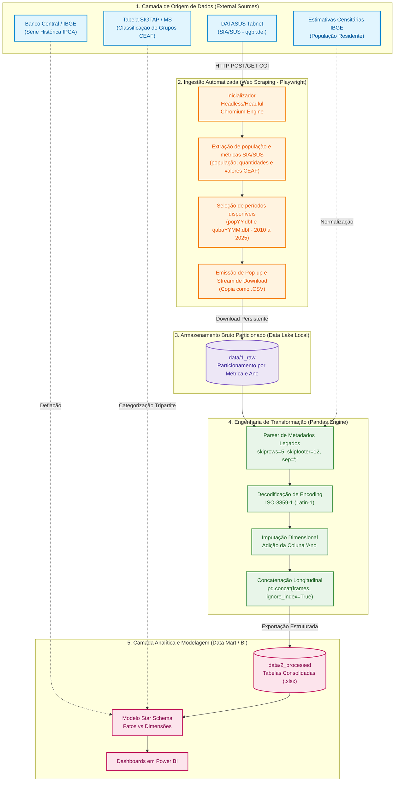
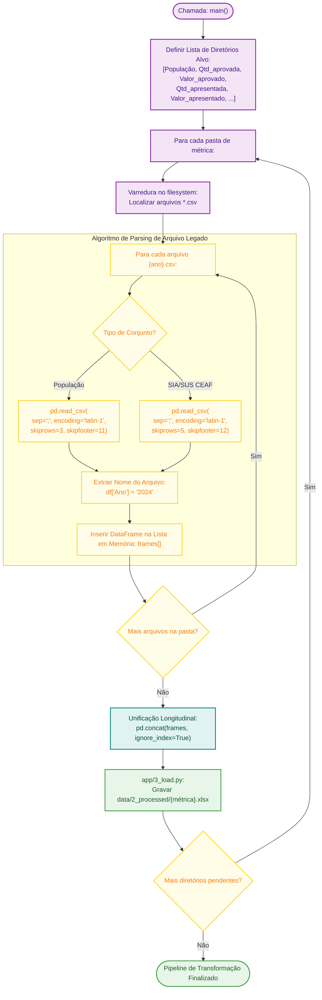
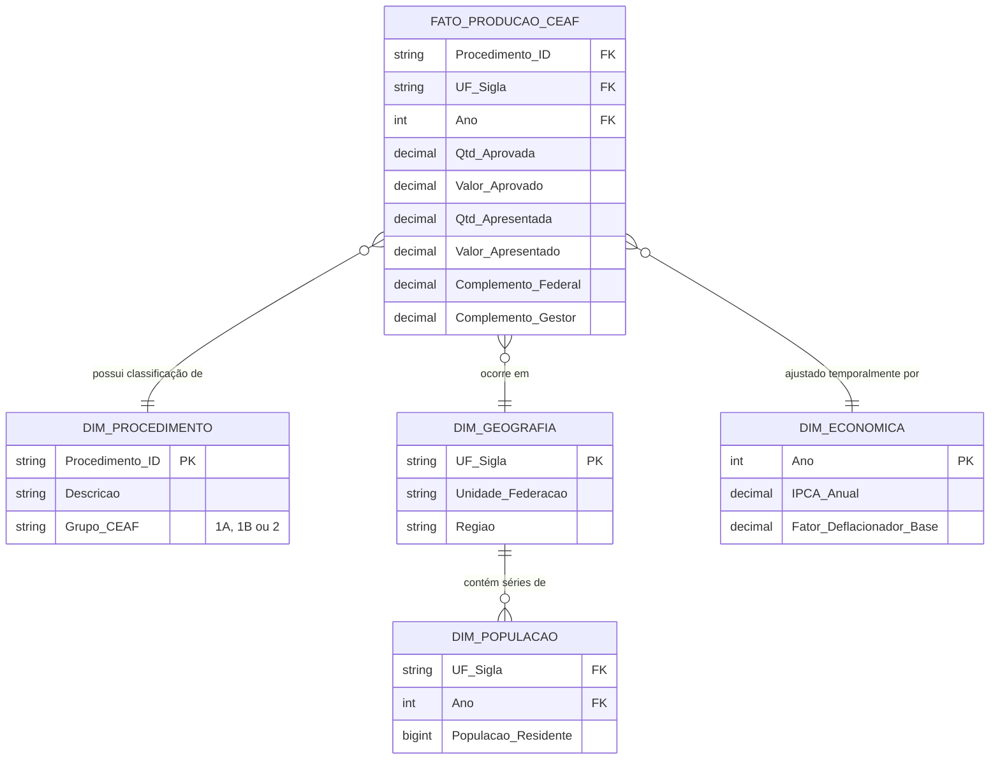

# Evolution of CEAF in Bahia

[](https://www.python.org/)
[](https://playwright.dev/)
[](https://pandas.pydata.org/)
[](http://tabnet.datasus.gov.br/)
[]()
[](https://opensource.org/licenses/MIT)

Pipeline Automatizado de Mineração de Dados no SIA/SUS e Modelagem Farmacoeconômica da Assistência Farmacêutica

## Resumo (Abstract)

**Português**: O Componente Especializado da Assistência Farmacêutica (CEAF) representa uma das estratégias de maior complexidade clínica e impacto orçamentário no âmbito do Sistema Único de Saúde (SUS), congregando medicamentos de alto custo para patologias crônicas e raras. Contudo, a realização de estudos epidemiológicos e farmacoeconômicos em nível populacional depara-se com barreiras substanciais na extração sistemática de dados secundários governamentais hospedados na plataforma legada TABNET/DATASUS do Ministério da Saúde. Este projeto implementa um pipeline reprodutível de Engenharia de Dados em Saúde baseado em automação de navegadores (_browser robotics_) e processamento vetorizado para extração, higienização, estruturação longitudinal (2010–2025) e modelagem analítica multidimensional dos procedimentos ambulatoriais do CEAF para o Estado da Bahia e demais Unidades da Federação (UFs). A arquitetura viabiliza o monitoramento de indicadores-chave de desempenho (KPIs), análises de demanda reprimida, impacto de complementos orçamentários dos entes federados e correções inflacionárias em moeda constante.

**English**: The Specialized Component of Pharmaceutical Services (CEAF) is one of the most clinically critical and financially intensive segments of the Brazilian Unified Health System (SUS), providing high-cost treatments for chronic and rare diseases. However, population-level health economics and pharmacoepidemiological research frequently encounter data accessibility bottlenecks within the legacy TABNET/DATASUS portal. This repository delivers an automated, reproducible Health Data Engineering pipeline utilizing browser automation and vectorized tabular processing to systematically scrape, clean, aggregate, and model longitudinal CEAF outpatient records (2010–2025) across all Brazilian states, with a primary focus on Bahia. The resultant data infrastructure powers real-time KPI dashboards, budgetary strain analysis, per-capita spending trends, and real-value economic projections adjusted by inflation (IPCA).

---

## 1. Fundamentação Teórica e Contexto Institucional

A Assistência Farmacêutica no Brasil organiza-se sob a égide tripartite (União, Estados e Municípios), sendo o **CEAF** regulamentado primordialmente pela Portaria de Consolidação GM/MS nº 2/2017 (Anexo XXVIII). Sua gestão financeira é categorizada em grupos operacionais:

- **Grupo 1A**: Financiamento e aquisição centralizada pelo Ministério da Saúde (União);
- **Grupo 1B**: Financiamento compartilhado (aquisição estadual com repasse/ressarcimento federal);
- **Grupo 2**: Financiamento, aquisição e dispensação sob responsabilidade exclusiva dos Estados (Secretarias Estaduais de Saúde - SES/DASF);
- **Grupo 3**: Medicamentos sob a governança da Atenção Básica e responsabilidade municipal.

O acompanhamento da série histórica de aprovação e faturamento no **SIA/SUS** (Sistema de Informações Ambulatoriais) constitui elemento crítico para a **Diretoria de Assistência Farmacêutica (DASF/SESAB)** na formulação de políticas públicas, previsão de risco de desabastecimento, identificação de judicialização da saúde e planejamento orçamentário plurianual.

### O Desafio Técnico do TABNET / DATASUS

A interface pública do TABNET baseia-se em formulários Common Gateway Interface (`deftohtm.exe`), orientados a arquivos binários proprietários (`.def` e `.dbf`). As principais limitações operacionais para pesquisa em saúde compreendem:

1. Ausência de endpoints REST/GraphQL nativos ou APIs documentadas;
2. Limitação de seleção manual de meses e anos por sessão HTTP;
3. Arquivos CSV exportados com formatos híbridos: metadados textuais nas 5 primeiras linhas e rodapés institucionais nas últimas 12 linhas;
4. Codificação de caracteres legada em `ISO-8859-1` (Latin-1);
5. Nomenclatura opaca das opções de arquivos temporais no formato binário `qgbrYYMM.dbf`.

O presente software supera tais gargalos ao estabelecer um autômato determinístico e desacoplado em Python, garantindo a reprodutibilidade metodológica exigida em pesquisas científicas.

---

## 2. Fluxogramas Acadêmicos da Arquitetura e Funcionamento

Os fluxogramas a seguir modelam a arquitetura lógica, o fluxo de controle algorítmico e o ciclo de vida dos dados desde a requisição no DATASUS até a entrega analítica.

### Fluxograma 1: Macroarquitetura do Pipeline de Dados em Saúde (ETL End-to-End)



---

### Fluxograma 2: Algoritmo de Extração e Mineração Web (Playwright Robot Engine)

Este fluxograma detalha a rotina das métricas SIA/SUS implementada em `app/1_extract.py`. A população é extraída separadamente por `app/0_extract.py`.

```mermaid
flowchart TD
    classDef process fill:#E3F2FD,stroke:#1976D2,stroke-width:2px,color:#0D47A1;
    classDef decision fill:#FFF9C4,stroke:#FBC02D,stroke-width:2px,color:#F57F17;
    classDef event fill:#E8EAF6,stroke:#3F51B5,stroke-width:2px,color:#1A237E;
    classDef term fill:#FFEBEE,stroke:#D32F2F,stroke-width:2px,color:#B71C1C;
    classDef success fill:#E8F5E9,stroke:#4CAF50,stroke-width:2px,color:#1B5E20;

    Start(["Início do Processo de Extração"]):::process --> InitBrowser["Inicializar Chromium Context & Page"]:::process
    InitBrowser --> LoopConteudo["Iterar Métrica no Conjunto:<br/>[Qtd/Valor Aprovado, Qtd/Valor Apresentado,<br/>Complementos, Incremento]"]:::process

    LoopConteudo --> MkDir["Garantir existência de:<br/>data/1_raw/{conteudo_sanitizado}/"]:::process
    MkDir --> LoopAno["Iterar anos de 2010 a 2025"]:::process

    LoopAno --> LoadPage["Carregar URL Tabnet SIA/SUS:<br/>sia/cnv/qgbr.def (timeout=60s)"]:::process
    LoadPage --> SetDims["Configurar Linha = 'Procedimento'<br/>Configurar Coluna = 'UF'"]:::process
    SetDims --> SelectMetric["Selecionar Conteúdo = métrica atual"]:::process
    SelectMetric --> ExpandNodes["Expandir Árvores de Seleção:<br/>Click #fig17 (Grupo) e #fig18 (Subgrupo)"]:::process
    ExpandNodes --> SelectGroups["Grupo: '6' (Medicamentos)<br/>Subgrupo: '55' (CEAF)"]:::process

    SelectGroups --> GenCandidate["Gerar Vetor de Períodos Candidatos:<br/>qgbr{AA}{12..01}.dbf"]:::process
    GenCandidate --> InspectDOM["Inspecionar Opções no DOM:<br/>select[name='Arquivos']"]:::process
    InspectDOM --> FilterValid{"Intersecção de Períodos:<br/>periodos_validos > 0?"}:::decision

    FilterValid -- Não --> LogSkip["Registrar Log: Nenhum dado disponível.<br/>Incrementar Ano"]:::event
    LogSkip --> NextAnoCheck{"Mais anos no intervalo?"}:::decision

    FilterValid -- Sim --> SelectMonths["Selecionar Multi-Option de Períodos Válidos"]:::process
    SelectMonths --> SubmitForm["Aguardar evento: expect_popup()<br/>Disparar Click: 'Mostra'"]:::event
    SubmitForm --> PopupReady["Popup Aberta com Tabela HTML Renderizada"]:::process
    PopupReady --> TriggerDownload["Aguardar evento: expect_download()<br/>Disparar Click: 'Copia como .CSV'"]:::event
    TriggerDownload --> SaveFile["Persistir Arquivo em:<br/>data/1_raw/{conteudo}/{ano}.csv"]:::success
    SaveFile --> ClosePopup["Fechar Instância da Popup"]:::process

    ClosePopup --> NextAnoCheck
    NextAnoCheck -- Sim --> LoopAno
    NextAnoCheck -- Não --> NextMetricCheck{"Mais métricas na lista?"}:::decision

    NextMetricCheck -- Sim --> LoopConteudo
    NextMetricCheck -- Não --> Shutdown["Fechar Contexto e Encerrar Browser"]:::process
    Shutdown --> End(["Extração Web Concluída"]):::term
```



---

### Fluxograma 3: Sanitização, Limpeza de Metadados e Modelagem Vetorizada

Modelagem das etapas de transformação (`app/2_transform.py`) e gravação dos arquivos processados (`app/3_load.py`).



---

## 3. Especificação das Variáveis e Métricas do SIA/SUS

O pipeline extrai longitudinalmente os seguintes conteúdos definidos nos dicionários de dados do SIA/SUS:

| Métrica no Tabnet                  | Nome do Arquivo Sanitizado                                                                                     | Descrição Farmacoeconômica / Operacional                                                                           |
| :--------------------------------- | :------------------------------------------------------------------------------------------------------------- | :----------------------------------------------------------------------------------------------------------------- |
| **Qtd.aprovada**                   | [`data/2_processed/Qtd_aprovada.xlsx`](data/2_processed/Qtd_aprovada.xlsx)                                     | Volume físico de unidades farmacêuticas ou procedimentos cuja cobrança foi homologada e auditada pelo SUS.         |
| **Valor_aprovado**                 | [`data/2_processed/Valor_aprovado.xlsx`](data/2_processed/Valor_aprovado.xlsx)                                 | Montante financeiro efetivamente aprovado para repasse ou custeio governamental (R$).                              |
| **Qtd.apresentada**                | [`data/2_processed/Qtd_apresentada.xlsx`](data/2_processed/Qtd_apresentada.xlsx)                               | Quantitativo total faturado/cobrado pelos prestadores de serviços ambulatoriais e secretarias.                     |
| **Valor_apresentado**              | [`data/2_processed/Valor_apresentado.xlsx`](data/2_processed/Valor_apresentado.xlsx)                           | Custo bruto submetido a faturamento no sistema de informações (R$).                                                |
| **Valor_do_complemento_federal**   | [`data/2_processed/Valor_do_complemento_federal.xlsx`](data/2_processed/Valor_do_complemento_federal.xlsx)     | Aportes adicionais transferidos pela União para itens de alto custo com repasse diferenciado.                      |
| **Valor_do_complemento_do_gestor** | [`data/2_processed/Valor_do_complemento_do_gestor.xlsx`](data/2_processed/Valor_do_complemento_do_gestor.xlsx) | Contrapartida financeira aportada pelo tesouro estadual (ex.: SESAB) ou municipal para cobrir custos operacionais. |
| **Valor_do_incremento**            | [`data/2_processed/Valor_do_incremento.xlsx`](data/2_processed/Valor_do_incremento.xlsx)                       | Valores complementares autorizados em portarias ministeriais específicas.                                          |

---

## 4. Modelagem Dimensional e Fórmulas de Avaliação Farmacoeconômica

### Modelo Estrela (Star Schema) Integrado

Os dados processados em `data/2_processed/` e a base curada em `data/3_curated/` são destinados a consultas analíticas em Power BI, R ou Python.



### Formulações Matemáticas e Indicadores Estratégicos

1. **Taxa de Glosa / Reprovação Operacional ($T_{glosa}$)**:
   Mede a proporção de procedimentos ou custos não aprovados pelas auditorias estaduais/federais:
   $$T_{glosa} = \left( 1 - \frac{\text{Valor Aprovado}_{i,t}}{\text{Valor Apresentado}_{i,t}} \right) \times 100$$

2. **Gasto Real Per Capita Deflacionado pelo IPCA ($G_{real}^{capita}$)**:
   Permite comparar o investimento financeiro no CEAF da Bahia frente a outros estados sem as distorções inflacionárias do período:
   $$G_{real}^{capita} = \frac{\text{Valor Aprovado}_{uf, t} \times \left( \prod_{k=t}^{T_{base}} (1 + \pi_k) \right)}{\text{População Residente}_{uf, t}}$$
   _Onde $\pi_k$ representa o IPCA anual do período $k$._

3. **Índice de Esforço Fiscal Próprio do Gestor Estadual ($I_{gestor}$)**:
   $$I_{gestor} = \frac{\text{Valor do Complemento do Gestor}}{\text{Valor Aprovado Total}} \times 100$$

---

## 5. Estrutura do Repositório

```text
extrator_datasus/
│
├── app/
│   ├── 0_extract.py                    # População residente -> CSV em data/1_raw/População
│   ├── 1_extract.py                    # Tabnet -> CSV em data/1_raw
│   ├── 2_transform.py                  # CSV -> DataFrames normalizados
│   ├── 3_load.py                       # Grava processados e cria a base curated
│   ├── utils.py                        # Caminhos e configurações compartilhados
│   └── __init__.py
├── data/
│   ├── 1_raw/                          # CSVs brutos particionados por métrica e ano
│   │   ├── População/
│   │   ├── Qtd_apresentada/
│   │   ├── Qtd_aprovada/
│   │   ├── Valor_apresentado/
│   │   ├── Valor_aprovado/
│   │   ├── Valor_do_complemento_do_gestor/
│   │   ├── Valor_do_complemento_federal/
│   │   └── Valor_do_incremento/
│   ├── 2_processed/                    # Planilhas processadas (.xlsx)
│   │   ├── CEAF Por Grupo.xlsx
│   │   ├── Estados.xlsx
│   │   ├── IPCA.xlsx
│   │   ├── População.xlsx
│   │   └── Arquivos consolidados por métrica
│   └── 3_curated/                      # Base curada para análise
│       ├── CEAF 2016 a 2025.xls        # Base legada
│       └── CEAF_{ano inicial} a {ano final}.xlsx
├── main.py                             # Orquestrador do pipeline (CLI)
├── pyproject.toml                      # Metadados e dependências do projeto
└── README.md                           # Documentação do projeto
```

---

## 6. Guia de Reprodutibilidade Científica e Execução

### Pré-requisitos de Sistema

- **Python**: Versão `>= 3.12`
- **Gerenciador de Ambientes**: [uv](https://docs.astral.sh/uv/) (recomendado) ou `pip`/`venv`
- **Navegador para Automação**: Chromium (binários gerenciados pelo Playwright)
- **Conexão de Rede**: Acesso desimpedido ao domínio `tabnet.datasus.gov.br` (porta 80/HTTP)

### Passo a Passo de Instalação

1. **Clonar o Repositório**:

    ```bash
    git clone https://github.com/bernardonogueira8/EVOLUTION-OF-CEAF-IN-BAHIA.git
    cd EVOLUTION-OF-CEAF-IN-BAHIA
    ```

2. **Criar e Ativar o Ambiente Virtual com `uv`**:

    ```bash
    # Criar ambiente virtual
    uv venv

    # Ativação no Windows (PowerShell):
    .venv\Scripts\Activate.ps1

    # Ativação no Linux/macOS:
    source .venv/bin/activate
    ```

3. **Instalação das Dependências do Projeto**:

    ```bash
    uv sync
    ```

    _Ou utilizando o pip padrão:_

    ```bash
    pip install pandas playwright openpyxl
    ```

4. **Instalação dos Drivers de Automação do Playwright**:
    ```bash
    uv run playwright install chromium
    ```
    _Se as dependências foram instaladas com `pip`, execute `playwright install chromium` no ambiente virtual ativo._

### Execução do pipeline

Execute o pipeline completo (extração, transformação e gravação dos arquivos processados):

```bash
uv run python main.py
```

Também é possível executar uma etapa específica:

```bash
uv run python main.py --stage extract
uv run python main.py --stage transform
uv run python main.py --stage load
```

`extract` executa primeiro a extração de população residente na Bahia (`app/0_extract.py`) e depois as métricas do SIA/SUS (`app/1_extract.py`), salvando os CSVs em `data/1_raw`. `transform` lê os CSVs existentes, aplica o parsing específico de população e SIA/SUS e grava as planilhas em `data/2_processed`. `load` lê as quatro planilhas processadas de quantidade e valor, além de `População.xlsx`, e gera em `data/3_curated` uma linha por procedimento, macrorregião e período com as métricas e a população residente correspondente. A população é associada por macrorregião e período; a coluna `Total` é excluída e valores `-` ficam vazios (nulos), não são convertidos em zero. A saída é nomeada `CEAF_{ano inicial} a {ano final}.xlsx`, usando os anos disponíveis nos dados. O comando sem `--stage` executa as três etapas em sequência.

---

## 7. Conformidade Ética e Governança dos Dados

Em estrito alinhamento com os preceitos de integridade em pesquisa e governança de dados em saúde:

- **Dados Secundários de Acesso Público**: As informações extraídas provêm de registros administrativos anonimizados e agregados do SIA/SUS, disponibilizados publicamente pelo Ministério da Saúde em conformidade com a **Lei de Acesso à Informação (Lei nº 12.527/2011)**.
- **Isenção de Parecer de CEP/CONEP**: Nos termos das **Resoluções CNS nº 466/2012 e nº 510/2016**, pesquisas que utilizam exclusivamente dados secundários de acesso público, sem identificação nominal ou risco individual a sujeitos humanos, dispensam submissão prévia ao Sistema CEP/CONEP.
- **Boas Práticas de Web Scraping Responsável**: O crawler foi desenhado com delays implícitos de processamento e requisições focadas, mitigando sobrecarga aos servidores públicos do DATASUS.

---

## 8. Referências Bibliográficas e Normativas

1. **BRASIL. Ministério da Saúde.** _Portaria de Consolidação GM/MS nº 2, de 28 de setembro de 2017._ Consolidação das normas sobre as políticas nacionais de saúde do SUS. Anexo XXVIII - Do Componente Especializado da Assistência Farmacêutica. Brasília: Diário Oficial da União, 2017.
2. **BRASIL. Ministério da Saúde.** _Manual Técnico do Componente Especializado da Assistência Farmacêutica._ Departamento de Assistência Farmacêutica e Insumos Estratégicos (DAF/SCTIE/MS). Brasília: Ministério da Saúde, 2014.
3. **BAHIA. Secretaria da Saúde do Estado da Bahia.** _Diretoria de Assistência Farmacêutica (DASF)._ Protocolos e Acompanhamento da Produção do CEAF na Bahia. Salvador: SESAB, 2024.
4. **DRUMMOND, M. F. et al.** _Methods for the Economic Evaluation of Health Care Programmes._ 4th ed. Oxford: Oxford University Press, 2015.
5. **GUERRA JÚNIOR, A. A. et al.** _Avaliação econômica em saúde: desafios para a gestão no Sistema Único de Saúde._ Revista de Saúde Pública, v. 50, p. 55-65, 2016.
6. **DATASUS.** _Documentação do Sistema de Informações Ambulatoriais do SUS (SIA/SUS)._ Departamento de Informática do SUS, Ministério da Saúde, 2024. Disponível em: <http://datasus.saude.gov.br>.

---

## Licença

Este projeto é distribuído sob os termos da licença **MIT**, encorajando a reutilização acadêmica, reprodutibilidade científica e transparência na gestão de políticas públicas de saúde.
